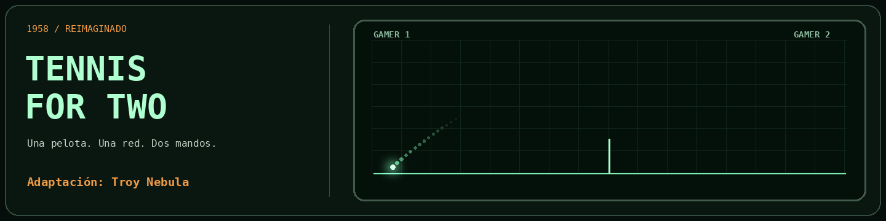

# Tennis for Two · Gamer 1 y Gamer 2

**Creadora de esta adaptación: Troy Nebula.**

Juego de tenis para dos personas en una misma pantalla, inspirado en el histórico Tennis for Two. Interfaz de osciloscopio y mandos táctiles. No requiere cuentas, servidor de aplicaciones ni instalación de dependencias.

## Cómo jugar

1. Coloca el dispositivo en horizontal y pulsa **Empezar partida**.
2. Gamer 1 juega a la izquierda; Gamer 2, a la derecha.
3. Mueve la rueda para elegir el ángulo y pulsa **GOLPE** para sacar.
4. Cuando la pelota entre en tu campo, pulsa **GOLPE** para devolverla, antes de que bote o después del primer bote.
5. Gana quien llegue a cinco puntos. Quien gana el punto realiza el siguiente saque.

Si la pelota bota en el campo rival y no se devuelve, gana el punto quien la lanzó. Mandarla directamente fuera, tocar la red o hacer que bote primero en el propio campo supone perder el punto.

Puedes elegir potencia **Suave / Media / Fuerte**, gravedad **Tierra / Luna / Júpiter**, pausar y reiniciar. En un ordenador, **A** golpea para Gamer 1 y **L** para Gamer 2; el ángulo se ajusta con las ruedas.

## Ejecutar en un ordenador

Abre `index.html` para jugar directamente. Para comprobar el funcionamiento como app web y el modo sin conexión, sirve la carpeta por HTTP local:

```sh
python -m http.server 8000
```

Después abre http://localhost:8000. Para instalar en móviles, utiliza el sitio publicado por HTTPS.

## Publicar tu primer proyecto en GitHub

Consulta `GUIA-GITHUB.md`: explica cómo subir los archivos y activar GitHub Pages para jugar desde un enlace.

## iPhone y iPad

Abre la dirección publicada en Safari → Compartir → Añadir a pantalla de inicio. Juega en horizontal. El juego intenta bloquear los gestos accidentales de zoom del navegador; el zoom de accesibilidad del sistema se configura en el dispositivo.

## Archivos

- `index.html`: interfaz, estilos y lógica del juego.
- `manifest.webmanifest`: configuración de la app web.
- `sw.js`: actualización y caché para uso sin conexión tras una primera carga correcta.
- `.nojekyll`: permite publicar los archivos estáticos sin procesamiento de Jekyll.
- `CREDITOS.md`: autoría y referencia histórica.
- `CHANGELOG.md`: versión de partida y cambios.

## Privacidad

El código no incluye analítica, publicidad, cuentas ni envío de puntuaciones. El servicio que aloje la página puede registrar accesos conforme a sus propias condiciones.

## Licencia

El código y las aportaciones propias de esta adaptación se ofrecen bajo **PolyForm Noncommercial License 1.0.0**. Texto completo en `LICENSE`.

Puedes usar, compartir y modificar el juego para fines no comerciales, conservando la licencia y el aviso obligatorio de autoría de **Troy Nebula**. La licencia no autoriza vender comercialmente el juego ni explotar comercialmente esta adaptación o sus modificaciones. Consulta el texto completo para los usos expresamente permitidos, incluidos los de instituciones educativas y otras organizaciones enumeradas en la licencia.

Required Notice: Copyright (c) 2026 Troy Nebula

Esta licencia se aplica únicamente a los derechos que la creadora puede conceder sobre esta adaptación. No concede derechos sobre el videojuego histórico ni materiales de terceros. La referencia a Tennis for Two reconoce la inspiración; no implica afiliación, autorización ni respaldo de sus creadores o de Brookhaven National Laboratory.

## Comprobaciones y límites

Esta edición deriva del código de la versión personal 9. Conserva su física y sus reglas. Se han comprobado la sintaxis, los archivos y la ausencia de nombres personales en esta distribución. Las correcciones anteriores se probaron por las personas usuarias en iPad; esta distribución con nombres genéricos requiere una prueba real en los dispositivos de destino.
